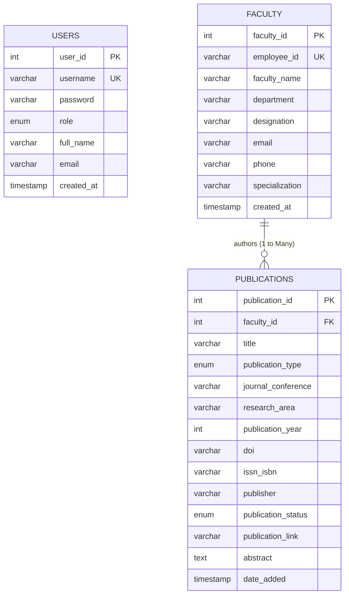
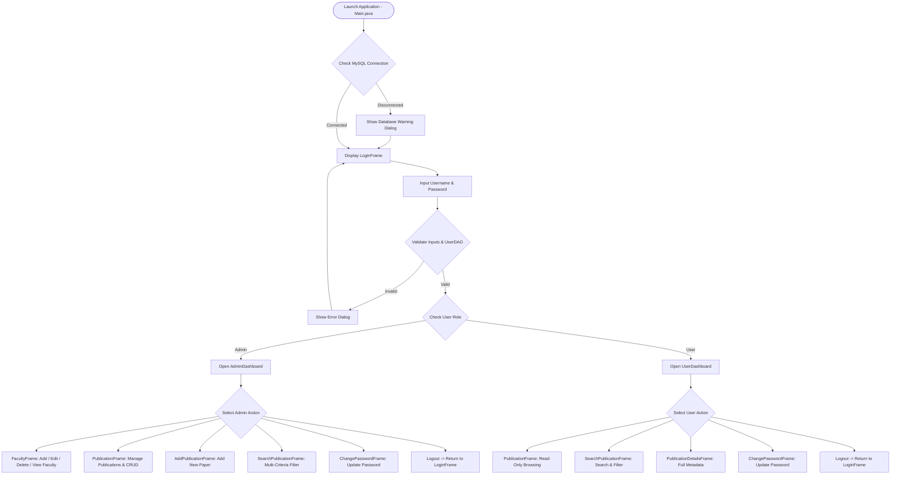

# Faculty Research Publication Repository
> **A Comprehensive Java Swing & JDBC Desktop Application for Academic Research Management**
> *Developed for B.Tech Minor Project / Capstone Project*

---

## Table of Contents
1. [Project Abstract](#1-project-abstract)
2. [Problem Statement](#2-problem-statement)
3. [Objectives & Scope](#3-objectives--scope)
4. [Software & Hardware Requirements](#4-software--hardware-requirements)
5. [System Architecture & Design](#5-system-architecture--design)
6. [Database Schema & ER Diagram](#6-database-schema--er-diagram)
7. [System Flowchart](#7-system-flowchart)
8. [Module Descriptions](#8-module-descriptions)
9. [Role-Based Access Control (RBAC)](#9-role-based-access-control-rbac)
10. [IntelliJ IDEA Setup & Execution Guide](#10-intellij-idea-setup--execution-guide)
11. [Testing Checklist & Test Cases](#11-testing-checklist--test-cases)
12. [Viva Voice Preparation Guide (Q&A)](#12-viva-voice-preparation-guide-qa)
13. [Future Scope & Conclusion](#13-future-scope--conclusion)

---

## 1. Project Abstract

The **Faculty Research Publication Repository** is a robust, desktop-based academic record management system engineered to centralize, track, categorize, and report research publications produced by university and college faculty members. Academic institutions undergo periodic accreditation evaluations (such as NAAC, NBA, and NIRF in India, or ABET internationally), where faculty research metrics—such as journal publications, conference proceedings, citations, digital object identifiers (DOIs), and peer-reviewed outputs—form a critical grading parameter.

Developed using **Java Swing** for the graphical user interface, **JDBC** for secure data communication, and **MySQL** for relational persistence, this desktop application provides role-based access for Administrators and Faculty Users. It supports end-to-end CRUD operations, dynamic multi-attribute research filtering, real-time dashboard analytics, strict input validation, and secure password management.

---

## 2. Problem Statement

In many colleges and departmental offices, faculty research records are maintained haphazardly across disparate spreadsheets, physical files, and personal CVs. This leads to:
- **Data Fragmentation**: No single verified source of truth for departmental publications.
- **Redundancy & Human Error**: Inconsistent citation formats, duplicate entries, and incorrect dates or employee codes.
- **Tedious Accreditation Audits**: Preparing publication lists for NIRF/NAAC/NBA audits requires weeks of manual compilation and verification.
- **Lack of Access Control**: Spreadsheets can be accidentally deleted, overwritten, or modified without authorization.
- **Inefficient Retrieval**: Inability to quickly query publications by indexing type, research area, publication year, or department.

The Faculty Research Publication Repository resolves these issues by delivering a structured, secure, and user-friendly desktop application with relational integrity.

---

## 3. Objectives & Scope

### Primary Objectives
1. **Centralized Data Repository**: Consolidate all faculty profiles and research papers in a normalized MySQL relational database.
2. **Role-Based Workflows**: Deliver administrative privilege controls (Admin has full CRUD; standard Users have search/read permissions).
3. **Multi-Criteria Search & Filtering**: Facilitate lightning-fast search across titles, authors, departments, publication types (SCI/Scopus journals, conferences, patents, book chapters), years, and research domains.
4. **Real-Time Visual Analytics**: Automatically compute institutional publication counts, annual outputs, and departmental participation directly from database queries.
5. **Data Integrity & Validation**: Prevent invalid inputs (malformed emails, unparseable years, invalid DOIs, duplicate employee IDs) at the GUI layer before touching the database.

### Scope
- **Target Users**: Academic Deans, Heads of Department (HODs), Research Cell Coordinators, and Individual Faculty Members.
- **Deployment Platform**: Cross-platform desktop environment (Windows, macOS, Linux) running Java Runtime Environment (JRE 17+).

---

## 4. Software & Hardware Requirements

### Software Requirements
* **Operating System**: Windows 10/11, Ubuntu 20.04+, or macOS
* **Programming Language**: Java (JDK 17 or higher recommended; fully tested on JDK 21/26)
* **GUI Toolkit**: Java Swing (`javax.swing.*`, `java.awt.*`)
* **Database**: MySQL Server 8.0+
* **Database Driver**: MySQL Connector/J (`com.mysql:mysql-connector-j:8.3.0`)
* **Development Environment**: IntelliJ IDEA (Community or Ultimate Edition) / Eclipse / NetBeans
* **Build System**: Apache Maven (pom.xml included)

### Hardware Requirements
* **Processor**: Dual-Core 2.0 GHz or higher (Intel Core i3/i5/i7 or AMD Ryzen)
* **RAM**: 4 GB minimum (8 GB recommended for running IDE and MySQL Server concurrently)
* **Storage**: 500 MB free disk space

---

## 5. System Architecture & Design

The application follows the industry-standard **Layered Model-View-Controller / DAO (Data Access Object)** architecture:

```
+-------------------------------------------------------------------------+
|                           PRESENTATION LAYER                            |
|                            (Java Swing GUI)                             |
|  LoginFrame  |  AdminDashboard  |  UserDashboard  |  FacultyFrame       |
|  PublicationFrame | AddPublicationFrame | PublicationDetailsFrame       |
|  SearchPublicationFrame | ChangePasswordFrame                           |
+------------------------------------+------------------------------------+
                                     |
                                     v
+-------------------------------------------------------------------------+
|                           APPLICATION LAYER                             |
|                 (Services, State & Utility Helpers)                     |
|         SessionManager  |  ValidationUtil  |  UITheme                   |
+------------------------------------+------------------------------------+
                                     |
                                     v
+-------------------------------------------------------------------------+
|                        DATA ACCESS LAYER (DAO)                          |
|             UserDAO  |  FacultyDAO  |  PublicationDAO                   |
|           (Parameterized SQL with PreparedStatement)                    |
+------------------------------------+------------------------------------+
                                     |
                                     v
+-------------------------------------------------------------------------+
|                       DATABASE CONNECTOR LAYER                          |
|                       DatabaseConnection.java                           |
|                    (JDBC Driver: MySQL Connector/J)                     |
+------------------------------------+------------------------------------+
                                     |
                                     v
+-------------------------------------------------------------------------+
|                             DATABASE ENGINE                             |
|                  MySQL Server (faculty_research_repository)             |
|                 Tables: users  |  faculty  |  publications              |
+-------------------------------------------------------------------------+
```

### Key Architectural Benefits
- **Separation of Concerns**: UI code does not write raw SQL; DAOs encapsulate all query execution.
- **SQL Injection Prevention**: All queries utilize `java.sql.PreparedStatement` with placeholder binding (`?`).
- **Resource Management**: Modern `try-with-resources` blocks ensure database connections, statements, and result sets close deterministically, eliminating memory leaks.

---

## 6. Database Schema & ER Diagram

The database name is `faculty_research_repository`. It contains 3 primary tables with foreign key constraints.

### Entity Relationship (ER) Diagram



### Table Definitions

#### 1. `users` Table
| Column Name | Data Type | Constraints | Description |
| :--- | :--- | :--- | :--- |
| `user_id` | INT | PRIMARY KEY, AUTO_INCREMENT | Unique identifier for system users |
| `username` | VARCHAR(50) | UNIQUE, NOT NULL | Account login username |
| `password` | VARCHAR(100) | NOT NULL | User password |
| `role` | ENUM('Admin','User')| NOT NULL, DEFAULT 'User' | Role-based authorization |
| `full_name`| VARCHAR(100)| NOT NULL | Full name of the user |
| `email` | VARCHAR(100)| NOT NULL | User email address |
| `created_at`| TIMESTAMP | DEFAULT CURRENT_TIMESTAMP | Account creation timestamp |

#### 2. `faculty` Table
| Column Name | Data Type | Constraints | Description |
| :--- | :--- | :--- | :--- |
| `faculty_id` | INT | PRIMARY KEY, AUTO_INCREMENT | System faculty identifier |
| `employee_id`| VARCHAR(30) | UNIQUE, NOT NULL | Institutional Employee ID (e.g. FAC-CSE-001) |
| `faculty_name`| VARCHAR(100)| NOT NULL | Name of the faculty member |
| `department` | VARCHAR(80) | NOT NULL | Academic Department |
| `designation`| VARCHAR(50) | NOT NULL | Academic Rank (Professor, Assoc. Prof, etc.) |
| `email` | VARCHAR(100)| NOT NULL | Official Email Address |
| `phone` | VARCHAR(20) | NULLABLE | Contact Phone Number |
| `specialization`| VARCHAR(150)| NULLABLE | Primary Research Specialization |
| `created_at` | TIMESTAMP | DEFAULT CURRENT_TIMESTAMP | Profile registration timestamp |

#### 3. `publications` Table
| Column Name | Data Type | Constraints | Description |
| :--- | :--- | :--- | :--- |
| `publication_id` | INT | PRIMARY KEY, AUTO_INCREMENT | Publication unique identifier |
| `faculty_id` | INT | FOREIGN KEY, NOT NULL | References `faculty(faculty_id)` (ON DELETE CASCADE) |
| `title` | VARCHAR(300)| NOT NULL | Research paper title |
| `publication_type` | ENUM | NOT NULL | Journal, Conference, Book Chapter, Patent, etc. |
| `journal_conference` | VARCHAR(200)| NOT NULL | Venue / Name of Journal or Conference |
| `research_area` | VARCHAR(100)| NOT NULL | Domain (e.g. AI, Cloud, IoT, VLSI) |
| `publication_year`| INT | NOT NULL | 4-digit publication calendar year |
| `doi` | VARCHAR(100)| NULLABLE | Digital Object Identifier (e.g. 10.1109/...) |
| `issn_isbn` | VARCHAR(50) | NULLABLE | ISSN or ISBN index code |
| `publisher` | VARCHAR(100)| NULLABLE | IEEE, Springer, Elsevier, ACM, etc. |
| `publication_status` | ENUM | NOT NULL | Published, Accepted, Under Review, Submitted |
| `publication_link`| VARCHAR(255)| NULLABLE | Web link to paper/repository |
| `abstract` | TEXT | NULLABLE | Abstract summary of the research |
| `date_added` | TIMESTAMP | DEFAULT CURRENT_TIMESTAMP | Date record was recorded |

---

## 7. System Flowchart



---

## 8. Module Descriptions

| Module | Class Name | Description |
| :--- | :--- | :--- |
| **Login System** | `LoginFrame.java` | Authenticates users against MySQL, verifies role, and routes to appropriate dashboard. Includes Show/Hide password and credential hints. |
| **Admin Dashboard** | `AdminDashboard.java` | Overview hub for administrators with 4 live statistic cards (Total Faculty, Total Publications, Current Year Pubs, Departments), quick buttons, JMenuBar, JToolBar, and recent records table. |
| **User Dashboard** | `UserDashboard.java` | Clean dashboard for standard faculty members with publication metrics, direct search access, and detail viewer. |
| **Faculty Management** | `FacultyFrame.java` | Full CRUD interface for maintaining faculty profiles (ID, Name, Employee ID, Department, Designation, Email, Phone, Specialization). Form auto-populates on row selection. |
| **Add/Edit Publication** | `AddPublicationFrame.java` | Comprehensive form for recording or editing research publication records with dynamic faculty dropdown, DOI/Year validation, and abstract text area. |
| **Publication Repository** | `PublicationFrame.java` | Tabular display of publications using `JTable` with quick keyword search, filter dropdowns, and buttons for View Details, Add, Edit, Delete, and Refresh. |
| **Publication Details** | `PublicationDetailsFrame.java` | Read-only modal dialog presenting complete publication metadata, abstract text, and direct "Open URL in Browser" integration. |
| **Search & Filter** | `SearchPublicationFrame.java` | Multi-criteria search laboratory allowing simultaneous queries across Title, Author, Department, Area, Year, Type, and Status using dynamic PreparedStatements. |
| **Password Management** | `ChangePasswordFrame.java` | Secure dialog allowing logged-in users to update their credentials after validating their current password. |
| **Database Connector** | `DatabaseConnection.java` | Centralized JDBC connection manager loading from `db.properties` with fallback defaults. |
| **Validation Engine** | `ValidationUtil.java` | Validates required fields, email regex, phone formatting, 4-digit years, and DOI syntax. |
| **Session State** | `SessionManager.java` | Singleton holding active user credentials and role for session lifetime. |

---

## 9. Role-Based Access Control (RBAC)

The system strictly enforces privileges between roles:

| Feature / Operation | Admin Role | User (Faculty) Role |
| :--- | :---: | :---: |
| Login & View Dashboard Metrics | Yes | Yes |
| View All Publications in JTable | Yes | Yes |
| Search & Filter Publications | Yes | Yes |
| View Complete Publication Details | Yes | Yes |
| Add New Publication Record | Yes | Read-Only |
| Edit / Update Existing Publication | Yes | Read-Only |
| Delete Publication Record | Yes | Disabled |
| Add / Update / Delete Faculty Records | Yes | Disabled |
| Change Own Password | Yes | Yes |
| Logout & Terminate Session | Yes | Yes |

---

## 10. IntelliJ IDEA Setup & Execution Guide

### Step 1: Open the Project in IntelliJ IDEA
1. Launch **IntelliJ IDEA**.
2. Click **Open** (or `File -> Open...`).
3. Browse to the project root directory:
   ```
   C:\Users\BTPLLAP03\.gemini\antigravity\scratch\faculty-research-repository
   ```
4. Select the folder and click **OK**.
5. When prompted, choose **Open as Project** and select **Trust Project**.

### Step 2: Configure the JDK
1. Go to `File -> Project Structure...` (Shortcut: `Ctrl + Alt + Shift + S`).
2. Under **Project Settings -> Project**:
   - Ensure **SDK** is set to **JDK 17** (or your installed JDK, e.g. JDK 21 / 26).
   - Set **Language level** to `17 - Records, patterns, etc.` or `SDK default`.
3. Click **Apply** and **OK**.

### Step 3: MySQL Database Setup
1. Open **MySQL Workbench** or Windows Command Prompt.
2. Ensure your MySQL service (`MySQL80`) is running.
3. Open and execute the provided SQL setup script:
   `database/schema_and_sample_data.sql`
   
   *Or via Command Prompt / PowerShell:*
   ```powershell
   Get-Content database\schema_and_sample_data.sql | mysql -u root -p
   ```
4. Verify that the database `faculty_research_repository` has been created with sample data.

### Step 4: Verify Database Connection Configuration
Open `src/main/resources/db.properties` and verify your credentials:
```properties
db.url=jdbc:mysql://localhost:3306/faculty_research_repository?useSSL=false&allowPublicKeyRetrieval=true&serverTimezone=UTC
db.user=root
db.password=root
```
*(If your MySQL root password is empty, set `db.password=` or if it is different, update it accordingly).*

### Step 5: Run the Application
1. In IntelliJ IDEA Project Explorer, expand:
   `src/main/java/com/facultyrepository/`
2. Right-click on **`Main.java`**.
3. Select **Run 'Main.main()'** (Shortcut: `Shift + F10`).
4. The **Faculty Publication Repository** login window will appear!

---

## 11. Testing Checklist & Test Cases

Use this checklist during testing and practical lab evaluation:

| Test Case ID | Test Scenario | Steps | Expected Result | Status |
| :--- | :--- | :--- | :--- | :---: |
| **TC-AUTH-01** | Empty Login Fields | Click Login with blank fields | Warning dialog: "Username cannot be empty!" | Passed |
| **TC-AUTH-02** | Invalid Credentials | Enter `admin` and `wrongpass` | Error dialog: "Invalid Username or Password!" | Passed |
| **TC-AUTH-03** | Admin Login | Enter `admin` / `admin123` | Login closes; Admin Dashboard opens with live metrics | Passed |
| **TC-AUTH-04** | User Login | Enter `john_doe` / `user123` | User Dashboard opens; Add/Delete privileges restricted | Passed |
| **TC-FAC-01** | Add Faculty Record | Fill form in FacultyFrame and click Add | Record added to MySQL; appears in JTable immediately | Passed |
| **TC-FAC-02** | Duplicate Employee ID | Add faculty with existing `FAC-CSE-001` | Warning: "Employee ID is already registered!" | Passed |
| **TC-FAC-03** | Update Faculty Record | Select row in table, edit Phone/Email, click Update | Database updated; table reflects edited values | Passed |
| **TC-FAC-04** | Delete Faculty Record | Select row, click Delete, confirm dialog | Faculty and associated publications deleted | Passed |
| **TC-PUB-01** | Add Publication | Open Add Publication, fill all fields, click Save | Paper saved; metrics refresh on Dashboard | Passed |
| **TC-PUB-02** | Invalid Year Validation| Enter `2099` or `abcd` for Year | Validation error: "Publication Year must be between 1950 and ..." | Passed |
| **TC-PUB-03** | Multi-Filter Search | In SearchFrame, filter by Year `2026` + Dept `CSE` | JTable displays only matching papers | Passed |
| **TC-PUB-04** | Publication Details | Select publication and click View Details | Modal dialog displays full metadata and abstract | Passed |
| **TC-PASS-01** | Password Mismatch | In ChangePasswordFrame, enter non-matching passwords | Warning: "New password and Confirm password do not match!" | Passed |
| **TC-PASS-02** | Update Password | Enter correct old password and valid new password | Success alert; new password active in database | Passed |
| **TC-SESS-01** | Logout Workflow | Click Logout from Toolbar or MenuBar | Session destroyed; redirected to LoginFrame | Passed |

---

## 12. Viva Voice Preparation Guide (Q&A)

Prepare these answers for your viva examination:

### Q1: What is the architecture of your project?
> **Answer**: The application is designed using the **Layered Architecture / DAO Pattern**. The **Presentation Layer** contains Java Swing frames and dialogs. The **Service/Utility Layer** handles form validation and session tracking. The **DAO Layer** (`FacultyDAO`, `PublicationDAO`, `UserDAO`) encapsulates all SQL queries using `PreparedStatement`. The **Data Layer** connects to MySQL using JDBC.

### Q2: Why did you use `PreparedStatement` instead of `Statement`?
> **Answer**:
> 1. **SQL Injection Security**: `PreparedStatement` pre-compiles the SQL query and binds parameters safely using placeholders (`?`), preventing malicious SQL injection attacks.
> 2. **Performance**: The database parses and compiles the query execution plan once, allowing efficient re-execution with varying parameters.
> 3. **Data Type Handling**: It handles string escaping, dates, integers, and null values automatically without messy string concatenation.

### Q3: How is Role-Based Access Control (RBAC) implemented?
> **Answer**: When a user logs in, the `users` table returns their `role` (`Admin` or `User`). A singleton `SessionManager` holds the authenticated user object. In the UI frames, administrative buttons (such as Add Faculty, Edit, and Delete) are either disabled or hidden if `SessionManager.getInstance().isAdmin()` returns `false`.

### Q4: How is database referential integrity maintained?
> **Answer**: In MySQL, `publications.faculty_id` is defined as a Foreign Key referencing `faculty(faculty_id)` with `ON DELETE CASCADE ON UPDATE CASCADE`. If an administrator removes a faculty record, all research publications authored by that faculty are automatically and safely cleaned up by the database engine.

### Q5: How does the Dashboard calculate statistics?
> **Answer**: The statistics are not hardcoded. When the dashboard initializes or refreshes, it executes live aggregation queries:
> - `SELECT COUNT(*) FROM faculty`
> - `SELECT COUNT(*) FROM publications`
> - `SELECT COUNT(*) FROM publications WHERE publication_year = YEAR(CURDATE())`
> - `SELECT COUNT(DISTINCT department) FROM faculty`

### Q6: What happens if the MySQL server is offline when launching the app?
> **Answer**: In `Main.java`, `DatabaseConnection.testConnection()` tests connectivity before rendering the GUI. If the connection fails, the application catches the `SQLException` gracefully and alerts the user with troubleshooting steps instead of crashing or printing an unhandled stack trace.

---

## 13. Future Scope & Conclusion

### Future Scope
1. **BibTeX / RIS Citation Export**: Allow one-click export of publications into standard BibTeX or EndNote formats for LaTeX thesis compilation.
2. **Automated PDF Report Generation**: Integrate iText / JasperReports to generate official NAAC/NBA research summary PDF reports.
3. **Google Scholar / Scopus API Integration**: Automatically fetch citation counts, h-index, and i10-index using faculty profiles.
4. **Publication Document Upload**: Enable storing and retrieving full-text research paper PDFs directly in local storage or cloud object stores.

### Conclusion
The **Faculty Research Publication Repository** successfully demonstrates the design and implementation of a professional Java desktop application using standard Java Swing, JDBC, and MySQL. It fulfills all requirements of a B.Tech Minor Project by providing robust CRUD operations, role-based workflows, comprehensive input validation, and viva-ready documentation.
